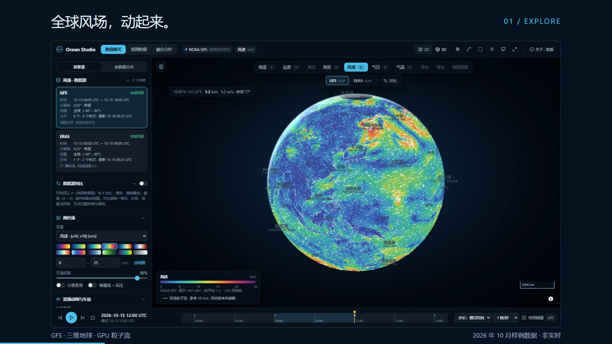
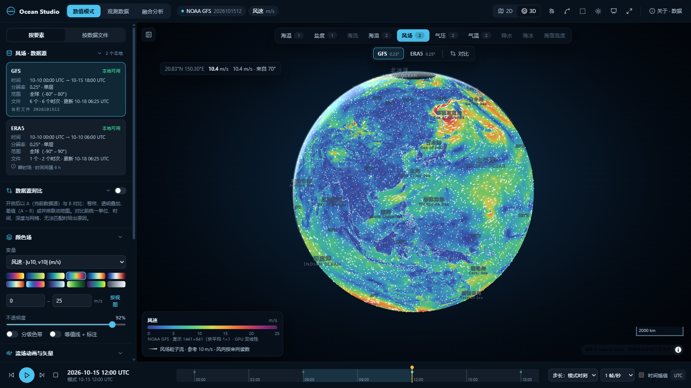
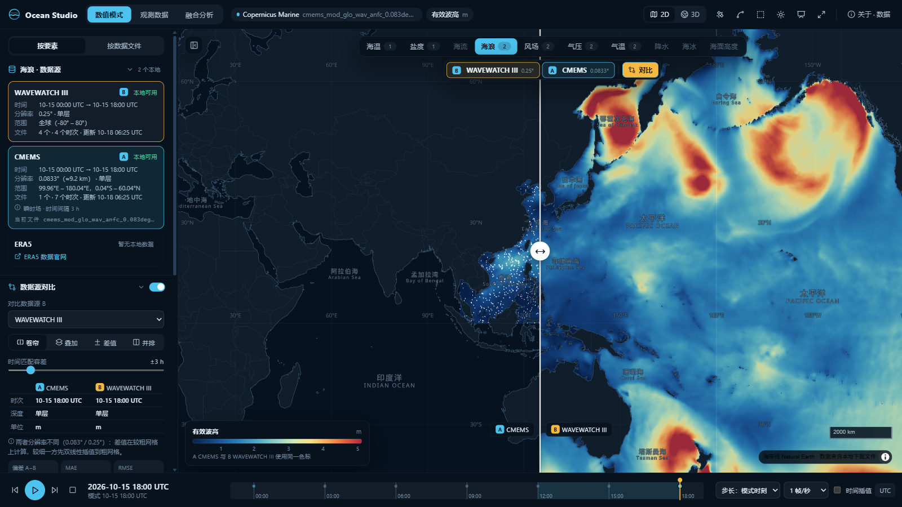
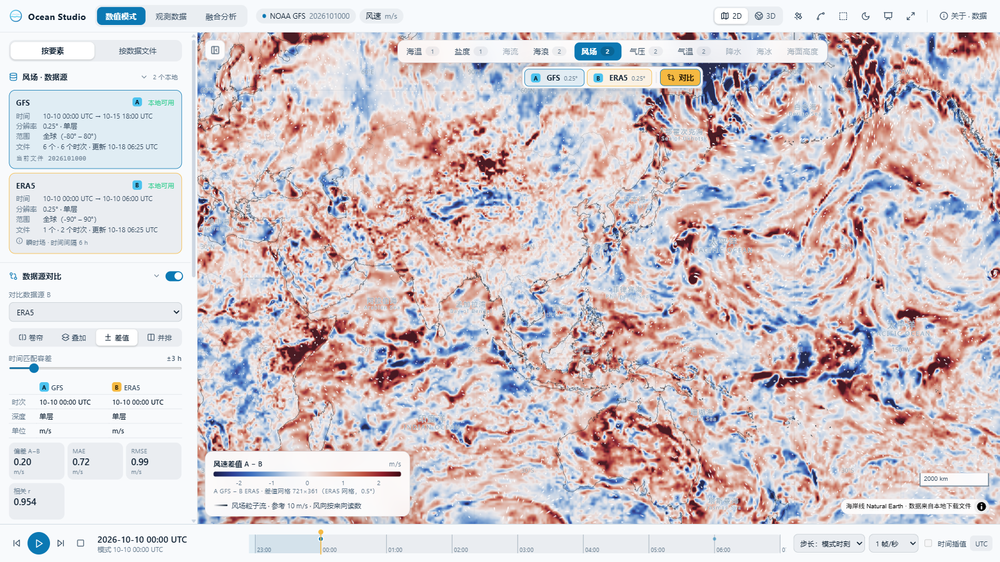
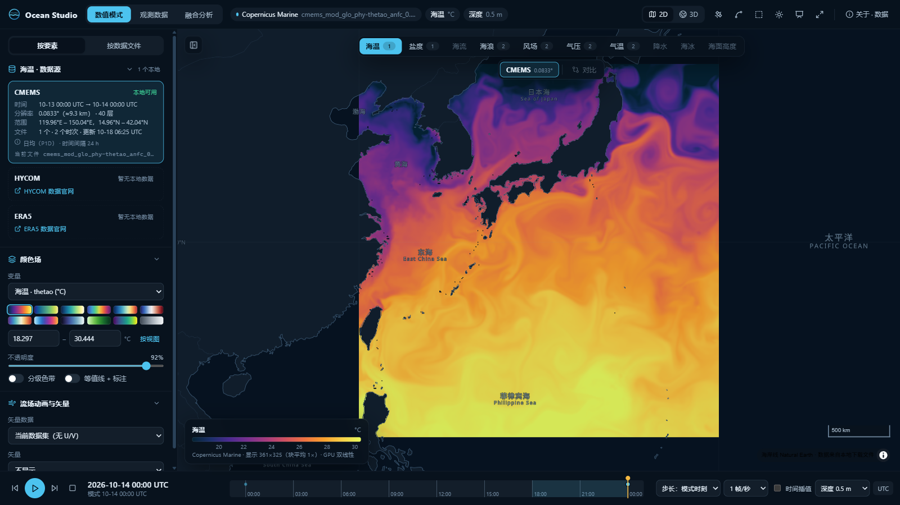
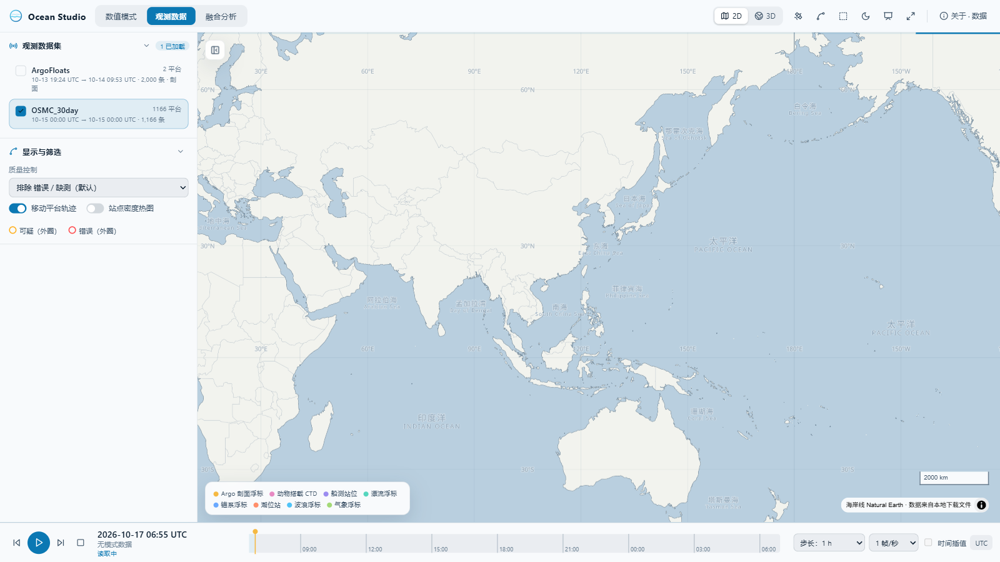

# Ocean Studio

Ocean Studio 是一个在浏览器里查看全球海洋和大气数据的工作台，可以浏览数值模式网格场和现场观测，也可以把两者放在一起检验。所有数值都直接从本地的 NetCDF / GRIB2 / ERDDAP CSV 文件读取，不做插补，也不填充缺测。

仓库自带约 76 MB 时间互相重叠的真实样例数据（GFS、WAVEWATCH III、CMEMS、ERA5、OSMC、Argo），克隆下来就能跑。

## 35 秒实机演示

[](https://github.com/kang340/ocean-studio/releases/download/v1.0.0/Ocean-Studio-showcase-X.mp4)

[播放 / 下载 MP4](https://github.com/kang340/ocean-studio/releases/download/v1.0.0/Ocean-Studio-showcase-X.mp4) · 1920×1080 · 30 fps · 中文字幕 · 无声，适合 X 信息流。展示随仓库附带的 **2026 年 10 月样例数据，并非实时数据流**。视频源码与复现步骤见 [promo-video/README.md](promo-video/README.md)，发布文案见 [docs/POST-X.md](docs/POST-X.md)。



| | |
|---|---|
|  |  |
|  |  |

## 功能

- 按要素浏览：海温、盐度、海流、海浪、风、气压、气温等，并显示每个要素有哪些数据源可用
- 二维地图和三维地球，GPU 渲染色斑图，风和海流用粒子流显示，另有等值线、分级色带
- 两个数据源对比：卷帘、叠加、A − B 差值、并排联动；时间、单位和网格先统一再比较
- 时间轴播放：同一网格、同一预报时效的多个文件会自动拼成一条时间序列
- 垂向断面、点位时间序列 / 剖面、框选区域统计
- 现场观测：平台轨迹、剖面、QC 分级（使用 Argo、PMEL、WOCE 等的原始质量码）、CSV 导出
- 模式–观测匹配：bias、RMSE、相关系数、散点和分时 / 分纬度统计；Argo 剖面对多层海温、盐度做垂向匹配
- 演示模式、浅色 / 深色主题；页面状态写在 URL 里，可以直接分享

## 快速开始

需要 Python ≥ 3.11 和 Node.js ≥ 20。

```bash
git clone https://github.com/kang340/ocean-studio.git
cd ocean-studio
pip install -r requirements.txt
cd web && npm ci && npm run build && cd ..
python server/app.py            # 打开 http://127.0.0.1:8000
```

也可以直接运行 `./start.sh`（Windows 用 `start.bat`）：首次运行会自动构建前端。

第一次打开页面会弹出“关于 · 数据”窗口，里面有 6 个一键示例场景。之后随时按 `?` 可以再次打开。

### 开发

```bash
python server/app.py              # 终端 1：API，端口 :8000
cd web && npm run dev             # 终端 2：Vite 开发服务器，/api 会代理到 :8000
```

测试：

```bash
pip install -r requirements-dev.txt && python -m pytest -q tests
cd web && npm test
```

## 使用自己的数据

数据目录里放数据文件，再加一个 `catalog.json` 登记这些文件：

```json
{
  "datasets": [
    { "id": "my-gfs-00z", "title": "GFS 2026-10-15 00Z", "provider": "gfs", "dataset": "2026101500",
      "format": "netcdf4", "path": "gfs/2026101500.nc", "options": { "forecast_hour": 0 } },
    { "id": "my-argo", "provider": "observations", "dataset": "ArgoFloats", "format": "csv",
      "path": "obs/argo.csv", "options": { "station_field": "platform_number", "vertical": "pres", "vertical_units": "dbar" } }
  ]
}
```

启动时用环境变量指向这个目录：

```bash
OCEAN_STUDIO_DATA=/path/to/my-data python server/app.py --port 8080
```

`samples/catalog.json` 是完整示例，`samples/README.md` 里有字段说明。读取 GRIB2 文件需要另外执行 `pip install -r requirements-grib.txt`。

## 结构

```
server/            FastAPI 服务（只读）
  app.py           入口：/api/viz、/api/studio，同时提供 web/dist 静态文件
  api/             visualize.py（网格切片、点 / 区域 / 断面查询）、studio.py（时间帧、观测、匹配）
  core/            gridview（切片与降采样）、obsdata（观测与 QC）、match（模式–观测匹配）、catalog（数据目录）
web/               React 19 + MapLibre GL 5 + uPlot，Vite 构建
  src/studio/      页面、GPU 图层（engine/）、地图（map/）、面板（ui/）、图表（charts/）
  public/          离线底图（Natural Earth）与字形
samples/           样例数据与 catalog.json
tools/             build_basemap.py：从 Natural Earth 重新生成底图
```

## 安全说明

服务只读：只会读取数据目录中、并且在 `catalog.json` 里登记过的文件，所有路径都限制在数据目录内。服务**没有身份认证**，默认只监听 `127.0.0.1`。如果用 `--host 0.0.0.0` 对外开放，同一网络中的任何人都能看到数据目录里的内容，请放在反向代理或其他访问控制之后。

## 致谢与许可

代码采用 [MIT License](LICENSE)。样例数据**不在** MIT 许可范围内，版权归各数据提供方所有，来源和引用方式见 [samples/README.md](samples/README.md)。

第三方组件：[MapLibre GL JS](https://github.com/maplibre/maplibre-gl-js)（BSD-3-Clause）、[React](https://react.dev)（MIT）、[uPlot](https://github.com/leeoniya/uPlot)（MIT）、[Lucide](https://lucide.dev)（ISC）、[Natural Earth](https://www.naturalearthdata.com)（公有领域）、[openmaptiles/fonts](https://github.com/openmaptiles/fonts)（OFL-1.1 / Apache-2.0）、[cmocean](https://github.com/matplotlib/cmocean) 色标（MIT，近似色阶）。可选的卫星底图来自 NASA GIBS Blue Marble（在线加载）。
